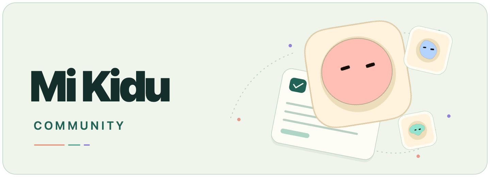

<picture>
  <source media="(prefers-color-scheme: dark)" srcset="docs/readme/hero-dark.png">
  
</picture>

# Mi Kidu Community

**Dale a tu IA un encargo más claro.** Mi Kidu es un compañero de código abierto para Mac y iPhone. Convierte una idea en una tarea clara, revisa exactamente qué vas a compartir y llévala a las herramientas de IA que ya usas.

[Probar](#probar) · [Conectar un proveedor](#conectar-un-proveedor) · [Hacer una primera contribución](#hacer-una-primera-contribución) · [Read in English](README.md)

## Qué puedes probar hoy

| | Mac | iPhone |
| --- | --- | --- |
| **Tu Kidu** | Crea un perfil por nombre. El personaje puede estar en el escritorio y aparecer en el Dock. | Crea un perfil por nombre. Elige un icono incluido para la pantalla de inicio desde **Perfil**. |
| **Tu encargo** | Añade objetivo, contexto, límites y resultado esperado. Edita el borrador antes de compartirlo. | Prepara y revisa el encargo en el mismo editor. |
| **Tus proveedores** | Envía un encargo revisado a tu OpenClaw, Codex CLI, Claude Code o adaptador local y lee la respuesta en Kidu. También puedes copiarlo. | Copia el texto revisado y envíalo desde tu propia sesión del proveedor. |

Un Apple Watch emparejado puede solicitar el perfil de Kidu desde el iPhone.

El mismo nombre normalizado da a Kidu la misma forma. El perfil y el borrador funcionan sin una cuenta de proveedor. La edición pública mantiene desactivada la vinculación con el perfil Familia de Kidual. [Cómo funciona el perfil](docs/PERFIL-FAMILIA.md) · [Privacidad](PRIVACY.md)

## Probar

Compila desde el código en un Mac con Swift 6 y Xcode. La app está dirigida a macOS 15 y iOS 18 o posteriores. Python 3 sirve para comprobar el proyecto generado.

```sh
git clone https://github.com/MeLlamoVictor/mi-kidu-community.git
cd mi-kidu-community
open MiKidu.xcodeproj
```

Ejecuta **MiKidu-Mac** para la app de escritorio o selecciona **MiKidu-iPhone** y un simulador de iPhone. Para un iPhone físico, copia [el ejemplo de firma](Config/Signing.local.xcconfig.example) a `Config/Signing.local.xcconfig` y configura tu propia firma. Consulta [las comprobaciones realizadas](VALIDATION.md) para saber qué se ha probado en compilación y dispositivos.

1. Escribe el nombre ficticio **Nube de Tiza** y pulsa **Continuar con mi nombre**. En una instalación vacía también puedes elegir **Abrir una copia** e importar el [perfil ficticio de demostración](Examples/demo-kidu.json).
2. Abre **Preparar contexto** y dale a Kidu una tarea pequeña. Prueba «Prepara una reunión de 15 minutos para un club de lectura ficticio». Pide tres puntos de agenda y una duración para cada uno.
3. Pulsa **Revisar encargo**, edita el borrador y cópialo o usa un proveedor que hayas configurado en el Mac.

## Conectar un proveedor

En Mac, elige un proveedor y selecciona el ejecutable que instalaste. OpenClaw también necesita el ID de un agente que hayas configurado para conversar. Kidu entrega el texto revisado por entrada estándar y muestra la respuesta o el error. El programa elegido se ejecuta con los permisos de tu propia instalación. [Configuración de proveedores y ejemplo de adaptador local](docs/PROVEEDORES.md)

**¿Quieres ver una respuesta sin cuenta de proveedor?** La guía incluye un adaptador local que repite tu encargo. Te permite comprobar la entrega completa en Mac con texto ficticio.

## Hacer una primera contribución

Abre Kidu en el Mac con **Nube de Tiza** e intenta preparar y revisar un encargo usando solo el teclado. Comprueba si el foco sigue el orden de los campos y vuelve al lugar correcto al cerrar la revisión. Si algo te estorba, [mira si ya hay una incidencia](https://github.com/MeLlamoVictor/mi-kidu-community/issues) y [cuenta los pasos](https://github.com/MeLlamoVictor/mi-kidu-community/issues/new?template=bug_report.md) con tu versión de macOS y el resultado esperado y observado.

Si quieres corregirlo, haz un fork, introduce un cambio concreto y ejecuta `swift test`. Incluye en la pull request cómo comprobaste el resultado. Las correcciones de documentación, las mejoras de accesibilidad y las sugerencias sobre el adaptador local son bienvenidas en inglés o español. [Guía de contribución](CONTRIBUTING.md)

## Licencia

El código está disponible bajo la [licencia MIT](LICENSE). El motor de avatares conserva [la atribución y la licencia de Blobatar](LICENSE-Blobatar.txt). La ilustración de portada utiliza iconos del proyecto público.
