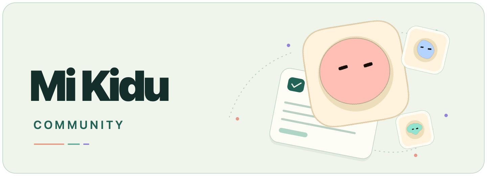

<picture>
  <source media="(prefers-color-scheme: dark)" srcset="docs/readme/hero-dark.png">
  
</picture>

# Mi Kidu Community

**Give your AI a better brief.** Mi Kidu is an open source companion for Mac and iPhone. Turn an idea into a clear task, review exactly what you’re sharing, then hand it to the AI tools you already use.

[Try it](#try-it) · [Connect a provider](#connect-a-provider) · [Make a first contribution](#make-a-first-contribution) · [Leer en español](README.es.md)

## What you can try today

| | Mac | iPhone |
| --- | --- | --- |
| **Your Kidu** | Create a profile by name. The character can sit on your desktop and appear in the Dock. | Create a profile by name. Choose a bundled Home Screen icon in **Perfil**. |
| **Your brief** | Add a goal, context, limits and an expected result. Edit the draft before handing it off. | Prepare and review the brief in the same editor. |
| **Your providers** | Send a reviewed brief to your own OpenClaw, Codex CLI, Claude Code or local adapter and read the reply in Kidu. You can also copy it. | Copy the reviewed text and send it from your own provider session. |

A paired Apple Watch can request the Kidu profile from the iPhone.

The same normalized name gives Kidu the same shape. The profile and draft work without a provider account. The public build leaves Kidual family profile linking disabled. [How the profile works](docs/PERFIL-FAMILIA.md) · [Privacy](PRIVACY.md)

## Try it

Build from source on a Mac with Swift 6 and Xcode. The app targets macOS 15 and iOS 18 or later. Python 3 is used to check the generated project.

```sh
git clone https://github.com/MeLlamoVictor/mi-kidu-community.git
cd mi-kidu-community
open MiKidu.xcodeproj
```

Run **MiKidu-Mac** for the desktop app or select **MiKidu-iPhone** and an iPhone simulator. For a physical iPhone, copy [the signing example](Config/Signing.local.xcconfig.example) to `Config/Signing.local.xcconfig` and set your own signing values. See [what has been validated](VALIDATION.md) for build and device coverage.

1. Enter the fictional name **Nube de Tiza** and choose **Continuar con mi nombre**. On an empty installation, you can also choose **Abrir una copia** and import the [fictional demo profile](Examples/demo-kidu.json).
2. Open **Preparar contexto** and give Kidu a small task. Try “Plan a 15-minute meeting for a fictional book club.” Ask for three agenda items and a time for each.
3. Choose **Revisar encargo**, edit the draft, then copy it or use a provider you’ve configured on Mac.

## Connect a provider

On Mac, pick a provider and choose the executable you installed. OpenClaw also needs the ID of an agent you’ve configured for conversation. Kidu passes the reviewed text on standard input and shows the response or an error. The program you choose runs with the permissions of your own installation. [Provider setup and local adapter example](docs/PROVEEDORES.md)

**Want a reply without a provider account?** The guide includes a local adapter that simply echoes your brief. It’s a way to check the full Mac handoff with fictional text.

## Make a first contribution

Open Kidu on Mac with **Nube de Tiza** and try preparing and reviewing a brief using only the keyboard. Check whether focus follows the order of the fields and returns to the right place when you close the review. If anything gets in the way, [check for an existing issue](https://github.com/MeLlamoVictor/mi-kidu-community/issues) and [report the steps](https://github.com/MeLlamoVictor/mi-kidu-community/issues/new?template=bug_report.md) with your Mac version and the expected and actual result.

If you’d like to fix it, fork the repository, make one focused change and run `swift test`. Include how you checked the result in the pull request. Documentation fixes, accessibility improvements and feedback on the local adapter are welcome in English or Spanish. [Contribution guide](CONTRIBUTING.md)

## License

Code is available under the [MIT License](LICENSE). The procedural avatar engine retains its [Blobatar attribution and license](LICENSE-Blobatar.txt). The cover illustration uses icons from the public project.
